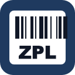

# Bitbeans.Zpl

[](https://github.com/bitbeans/Bitbeans.Zpl/actions/workflows/ci.yml)
[](https://www.nuget.org/packages/Bitbeans.Zpl)
[](https://www.nuget.org/packages/Bitbeans.Zpl.SkiaSharp)
[](https://www.nuget.org/packages/Bitbeans.Zpl.Viewer)
[](LICENSE)

.NET 10 libraries for the **Zebra Programming Language (ZPL II)**: build labels with typed elements,
convert images to printer graphics and render ZPL to PNG locally - **without ImageSharp**.

Bitbeans.Zpl is a maintained fork of [BinaryKits.Zpl](https://github.com/BinaryKits/BinaryKits.Zpl)
(MIT) that incorporates the SkiaSharp port by [ivanjx](https://github.com/ivanjx/BinaryKits.Zpl) and
fixes from open upstream pull requests. See [credits](#credits).

## Packages

| Package | Purpose | Dependencies |
| --- | --- | --- |
| [`Bitbeans.Zpl`](src/Bitbeans.Zpl/README.md) | Create ZPL labels with typed elements | **none** |
| [`Bitbeans.Zpl.SkiaSharp`](src/Bitbeans.Zpl.SkiaSharp/README.md) | Image conversion for `~DG` / `~DY` graphics | SkiaSharp |
| [`Bitbeans.Zpl.Viewer`](src/Bitbeans.Zpl.Viewer/README.md) | Parse ZPL and render it to PNG/JPEG/WebP | SkiaSharp, HarfBuzz, ZXing.Net |

All packages target **.NET 10**.

```shell
dotnet add package Bitbeans.Zpl
dotnet add package Bitbeans.Zpl.SkiaSharp   # only if you embed images
dotnet add package Bitbeans.Zpl.Viewer      # only if you render previews
```

## Quick start

### Create a label

```csharp
using Bitbeans.Zpl;
using Bitbeans.Zpl.Elements;

var elements = new List<ZplElementBase>
{
    new ZplTextField("Hello ZPL", 50, 50, new ZplFont(fontWidth: 40, fontHeight: 40)),
    new ZplBarcode128("123ABC", 50, 120),
    new ZplGraphicBox(30, 30, 500, 300, borderThickness: 4),
};

string zpl = new ZplEngine(elements).ToZplString(new ZplRenderOptions());
```

### Render a preview

```csharp
using Bitbeans.Zpl.Viewer;

IPrinterStorage printerStorage = new PrinterStorage();
var analyzer = new ZplAnalyzer(printerStorage);
var drawer = new ZplElementDrawer(printerStorage);

AnalyzeInfo analyzeInfo = analyzer.Analyze(zpl);
foreach (LabelInfo label in analyzeInfo.LabelInfos)
{
    // 4 x 6 inch label at 203 dpi (8 dots per mm)
    byte[] png = drawer.Draw(label.ZplElements, labelWidth: 101.6, labelHeight: 152.4, printDensityDpmm: 8);
    File.WriteAllBytes("label.png", png);
}
```

## Documentation

| Topic | |
| --- | --- |
| [Creating labels](docs/labels.md) | Elements, engine, render options, DPI scaling, text and barcodes |
| [Images](docs/images.md) | `~DG` vs. `~DY`, `IImageConverter`, writing your own converter |
| [Viewer](docs/viewer.md) | Rendering, `DrawerOptions`, fonts, bitmap fonts, logging, formats |
| [Supported commands](docs/viewer-support.md) | Barcode and command support matrix of the viewer |
| [Printing](docs/printing.md) | Sending ZPL to a printer |
| [Migrating from BinaryKits.Zpl](docs/migration.md) | Namespace map and breaking changes |
| [Changelog](CHANGELOG.md) | Release notes |

## Building

```shell
dotnet build Bitbeans.Zpl.slnx
dotnet test Bitbeans.Zpl.slnx
pwsh ./eng/coverage.ps1          # tests + merged coverage report + threshold check
```

See [CONTRIBUTING.md](CONTRIBUTING.md) for conventions.

## Credits

- [BinaryKits.Zpl](https://github.com/BinaryKits/BinaryKits.Zpl) by Binary Kits Pte. Ltd. and contributors - the original project (MIT)
- [ivanjx/BinaryKits.Zpl](https://github.com/ivanjx/BinaryKits.Zpl) - SkiaSharp port, bitmap fonts and many viewer improvements (MIT)
- Upstream pull request [#332](https://github.com/BinaryKits/BinaryKits.Zpl/pull/332) by MatteoH2O1999 - field finalization at `^FS`

## License

[MIT](LICENSE). The original copyright notice of Binary Kits Pte. Ltd. is retained.
