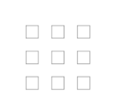

# Creating labels

`Bitbeans.Zpl` describes a label as a list of typed elements and renders it to ZPL II.
The package has no dependencies.

```csharp
using Bitbeans.Zpl;
using Bitbeans.Zpl.Elements;
```

## Elements and the engine

Every element derives from `ZplElementBase`. A single element can be rendered on its own:

```csharp
string zpl = new ZplGraphicBox(100, 100, 100, 100).ToZplString();
```

A complete label is rendered with `ZplEngine`, which is a `List<ZplElementBase>`:

```csharp
var engine = new ZplEngine
{
    new ZplTextField("Shipping label", 50, 40, new ZplFont(fontWidth: 40, fontHeight: 40)),
    new ZplGraphicBox(30, 20, 740, 1160, borderThickness: 4),
    new ZplBarcode128("1Z999AA10123456784", 60, 120, height: 150),
    new ZplQrCode("https://example.com", 500, 120, magnificationFactor: 5),
};

engine.AddRawZplCode("^FO50,400^GB700,3,3^FS"); // raw ZPL is passed through unchanged

string zpl = engine.ToZplString(new ZplRenderOptions { AddEmptyLineBeforeElementStart = true });
```

`Render(options)` returns the individual lines instead of a single string.

## Available elements

| Area | Elements |
| --- | --- |
| Text | `ZplTextField`, `ZplFieldBlock`, `ZplSingleLineFieldBlock`, `ZplTextBlock`, `ZplFont`, `ZplChangeInternationalFont` |
| 1D barcodes | `ZplBarcode11`, `ZplBarcode39`, `ZplBarcode93`, `ZplBarcode128`, `ZplBarcodeEan8`, `ZplBarcodeEan13`, `ZplBarcodeUpcA`, `ZplBarcodeUpcE`, `ZplBarcodeUpcExtension`, `ZplBarcodeInterleaved2of5`, `ZplBarcodeIndustrial2of5`, `ZplBarcodeAnsiCodabar`, `ZplBarcodeMsi`, `ZplBarcodeLogmars` |
| 2D barcodes | `ZplQrCode`, `ZplDataMatrix`, `ZplPDF417`, `ZplAztecBarcode`, `ZplMaxiCode` |
| Graphics | `ZplGraphicBox`, `ZplGraphicCircle`, `ZplGraphicEllipse`, `ZplGraphicDiagonalLine`, `ZplGraphicSymbol`, `ZplGraphicField`, `ZplReferenceGrid` |
| Images | `ZplDownloadGraphics` (`~DG`), `ZplRecallGraphic` (`^XG`), `ZplDownloadObjects` (`~DY`), `ZplImageMove` (`^IM`) - see [Images](images.md) |
| Formats | `ZplFieldNumber` (`^FN`), `ZplRecallFieldNumber`, `ZplRecallFormat` (`^XF`) |
| Misc | `ZplRaw`, `ZplFieldOrigin`, `ZplFieldTypeset`, `ZplFieldOrientation` |

## Render options

| Option | Default | Effect |
| --- | --- | --- |
| `AddStartEndFormat` | `true` | Wrap the output in `^XA` ... `^XZ` |
| `AddDefaultLabelHome` | `true` | Emit `^LH0,0` |
| `AddEmptyLineBeforeElementStart` | `false` | Blank line between elements (readability) |
| `DisplayComments` | `false` | Emit element `Comments` in a `^FX` block |
| `CompressedRendering` | `false` | Render every element on a single line |
| `SourcePrintDpi` / `TargetPrintDpi` | `203` / `203` | Scale coordinates and sizes by `Target / Source` (see below) |

### Scaling for another printer resolution

Design the label once (for example at 203 dpi) and render it for a 300 dpi printer:

```csharp
var options = new ZplRenderOptions { SourcePrintDpi = 203, TargetPrintDpi = 300 };
string zpl = new ZplEngine(elements).ToZplString(options);
```

Positions, sizes, font sizes and line thicknesses are scaled and rounded to whole dots. Module widths
(`^BY`) and QR/Aztec magnification are scaled and limited to 1 to 10. Exceptions:

- `ZplGraphicField` (`^GF`) data is written unchanged, only its position is scaled. Use
  `ZplDownloadGraphics`, which scales the image itself.
- Box corner rounding (`^GB` parameter r, 0 to 8) is a ratio and is not scaled.

### Comments for debugging

```csharp
var field = new ZplTextField("AAA", 50, 100, ZplConstants.Font.Default);
field.Comments.Add("An important field");

string zpl = new ZplEngine { field }.ToZplString(new ZplRenderOptions { DisplayComments = true });
```

## Text

```csharp
var text = "[_~^][LineBreak\n][The quick fox jumps over the lazy dog.]";
var font = new ZplFont(fontWidth: 50, fontHeight: 50);

var engine = new ZplEngine
{
    // ZPL control characters are replaced by spaces
    new ZplTextField(text, 10, 10, font),
    // ZPL control characters are escaped as hex values using ^FH
    new ZplTextField(text, 10, 50, font, hexadecimalIndicator: '_'),
    // only the first line is printed
    new ZplSingleLineFieldBlock(text, 10, 150, 500, font),
    // at most 2 lines, overflow overwrites the last line
    new ZplFieldBlock(text, 10, 300, 400, font, maxLineCount: 2),
    // multi line text in a box
    new ZplTextBlock(text, 10, 600, 400, 100, font),
};
```

Positions are given in dots. By default an element is placed with `^FO` (field origin, top left);
pass `bottomToTop: true` to use `^FT` (field typeset, baseline).

## Layout

Coordinates are plain integers, so layouts are simple arithmetic; for example a 3 x 3 grid:

```csharp
var engine = new ZplEngine();
for (int column = 0; column < 3; column++)
{
    for (int row = 0; row < 3; row++)
    {
        engine.Add(new ZplGraphicBox(100 + column * 100, 100 + row * 100, 50, 50));
    }
}
```



## Templates (stored formats)

`ZplFieldNumber` wraps a field with `^FN` so it can be part of a format stored on the printer
(`^DF`). The format is recalled with `^XF` and the fields are filled by number:

```csharp
var template = new ZplEngine
{
    new ZplRaw("^DFR:LABEL.ZPL^FS"),
    new ZplFieldNumber(1, new ZplTextField(string.Empty, 50, 50, ZplConstants.Font.Default)),
};

var data = new ZplEngine
{
    new ZplRaw("^XFR:LABEL.ZPL^FS"),
    new ZplRecallFieldNumber(1, "Filled in"),
};

string zpl = template.ToZplString(new ZplRenderOptions()) + data.ToZplString(new ZplRenderOptions());
```

`ZplRecallFormat` renders `^XF` (for example `^XFR:LABEL.ZPL^FS`); the [viewer](viewer.md) also produces it
when it parses `^XF` and merges the stored format with its data when rendering. The format name is validated
(optional device letter and colon, no `^`, `~`, comma, further colon, whitespace or control characters).
